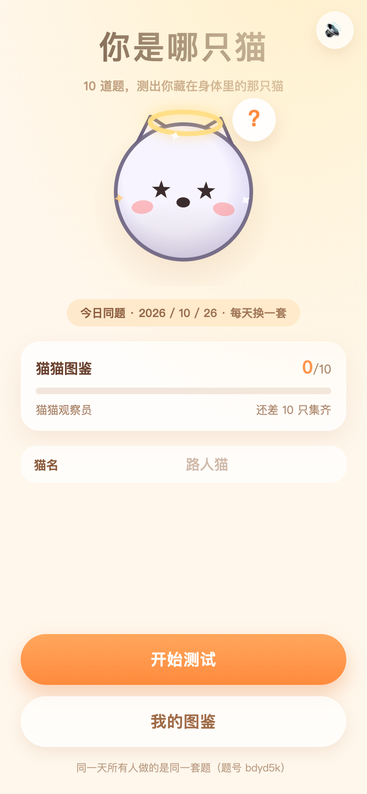
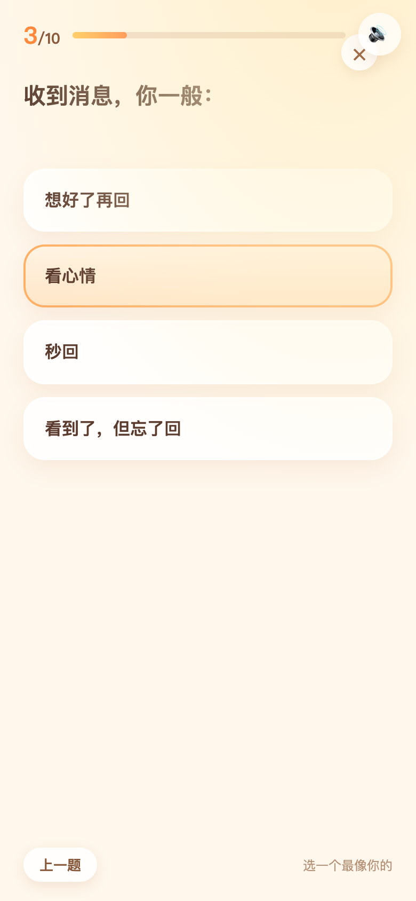
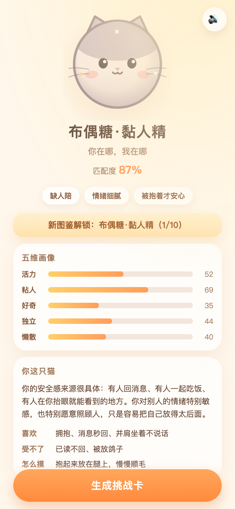
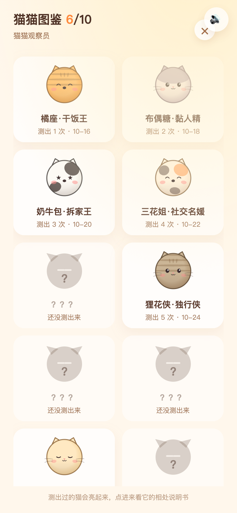
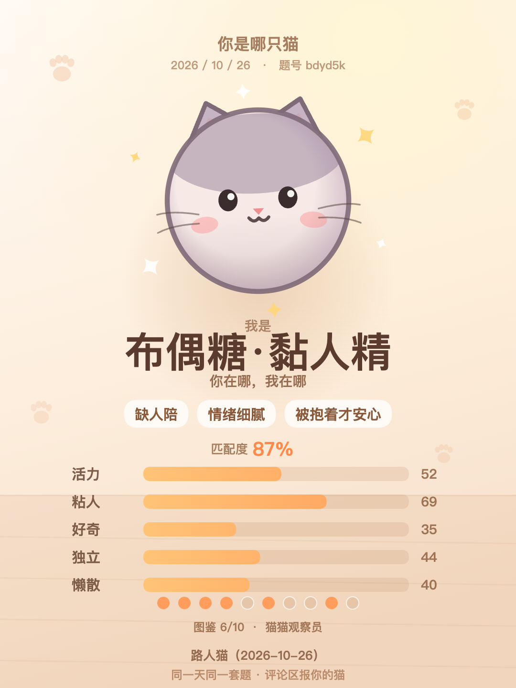

# 你是哪只猫 · Which Cat

10 道题，测出你藏在身体里的那只猫。竖屏 H5 人格测试，纯前端零依赖，可直接打包成小红书小工具。

> 同一天所有人做的是**同一套题**（题号相同），所以结果能直接在评论区对照——这就是它的「评论区挑战赛」玩法。
> 测出来的猫会进「猫猫图鉴」，换着答法多测几次，把 10 只猫收齐。



## 玩法

1. 打开就能看到今日猫猫和今日题号，点「开始测试」。
2. 10 道二选一式的四选一题（每题选最像你的那个），可以回上一题改。
3. 出结果：一只猫 + 匹配度 + 三个关键词 + 五维画像（活力 / 粘人 / 好奇 / 独立 / 懒散）+ 相处说明书。
4. 「生成挑战卡」得到 1080×1440 战绩卡，可发笔记或贴到评论区，朋友点进来做同一套题。
5. 被挑战过的记录会留在首页横幅上，测完直接告诉你「你和谁同款」。

| 答题 | 结果 | 图鉴 |
|---|---|---|
|  |  |  |

## 10 只结果猫

| # | 猫 | 标签 | 关键词 | 性格倾向 |
|---|----|------|--------|----------|
| 1 | 橘座 | 干饭王 | 心态好 / 干饭第一 / 谁都能聊 | 活力高、粘人、懒散 |
| 2 | 布偶糖 | 黏人精 | 缺人陪 / 情绪细腻 / 被抱着才安心 | 粘人拉满、独立极低 |
| 3 | 奶牛包 | 拆家王 | 精力过剩 / 鬼点子多 / 破坏力惊人 | 活力 + 好奇高、懒散极低 |
| 4 | 三花姐 | 社交名媛 | 会看气氛 / 人缘好 / 体面 | 活力 + 粘人 + 好奇都高 |
| 5 | 暹罗酱 | 吐槽役 | 嘴快 / 观察细 / 其实很软 | 好奇高、懒散低 |
| 6 | 狸花侠 | 独行侠 | 边界感强 / 自给自足 / 不爱解释 | 独立高、粘人极低 |
| 7 | 银渐层 | 高冷总裁 | 冷静 / 优雅 / 不好接近 | 活力 + 粘人低、独立高 |
| 8 | 抹布仔 | 社恐挂件 | 慢热 / 怕麻烦别人 / 熟了很闹 | 粘人、懒散、活力低 |
| 9 | 布丁 | 沙发土豆 | 低电量 / 会享受 / 不着急 | 懒散拉满 |
| 10 | 猫神 | 薛定谔的猫 | 想得很多 / 不好归类 / 有点神 | 好奇 + 独立双高 |

结果不是随机抽的：10 道题的选项各自带五个维度的权重，按当天题面标准化后算 z 值，再找最贴近的原型猫，所以**同样答案永远同一只猫**，匹配度也稳定。4000 次随机作答的分布是每只猫 7.6%～13%，不会出现「怎么测都是同一只」。



## 两个约定功能

- **评论区挑战赛**：战绩卡 + 评论草稿 + snapshot（游戏标识 / 结果编号 / 日期 / 昵称 / 题号），朋友从评论回到小工具时能读出你的结果，测完直接对比同款。snapshot 控制在 2KB 以内。
- **图鉴收集**：10 只猫各有一条收集记录（测出次数 + 首次日期），首页和结果页都有入口，未解锁显示剪影和「？？？」，集齐后称号升级为「猫猫图鉴大师」。缓存本地优先、容器 Storage 异步合并。

## 目录结构

```
which-cat/
├── index.html            # 单页骨架：首页 / 答题 / 结果 / 图鉴 / 挑战 / 详情
├── style.css             # 全部样式（Chrome 61 基线 + 新特性渐进增强）
├── js/
│   ├── compat.js         # 能力探测，挂 .supports-* 类
│   ├── config.js         # 10 只猫原型 / 20 道题库 / 每日种子
│   ├── art.js            # 矢量猫绘制（花色 / 配件 / 表情）
│   ├── art-extra.js      # 背景、光斑、星星、爪印、锁定剪影
│   ├── audio.js          # WebAudio 合成音效（无音频文件）
│   ├── xhs.js            # 小红书容器适配（postNote / 评论 / 存相册 / Storage / snapshot）
│   ├── challenge.js      # 挑战赛数据与文案
│   ├── collection.js     # 图鉴收集
│   ├── quiz.js           # 组题 / 标准化打分 / 结果匹配
│   ├── card.js           # 1080×1440 战绩卡与封面
│   └── main.js           # 流程控制与测试接口 window.WHICH
├── assets/               # 图标 1024/512/192/180（由同一套矢量绘制导出）
├── shots/                # README 与笔记用截图、卡片原图
├── scripts/              # 图标生成、小工具打包
├── tests/                # 功能验收 / 容器验收 / 截图
├── server.mjs            # 本地静态服务器（默认 5191）
└── which-cat-minitool.zip# 可直接上传的小工具包
```

## 本地运行

```bash
node server.mjs            # http://127.0.0.1:5191/
# 或者双击「启动游戏.command」（macOS）
```

零依赖：不需要 `npm install`，没有构建步骤，所有脚本都是经典 `<script>`。

## 测试

```bash
npm test               # 功能验收（125 项，真 Chrome 无头跑）
npm run test:minitool  # 小工具包验收（72 项，解压 zip + 假容器注入）
npm run minitool       # 重新打包 zip（含容器规范静态校验）
npm run shots          # 重新生成截图（需先启动本地服务器）
npm run icons          # 重新生成图标
npm run check          # 全部脚本语法检查
```

`window.WHICH` 暴露了测试接口（`start / answerAll / evaluate / collection / challenge / ui / storage` 等），所有断言都走真实点击和真实 Canvas 像素。

## 小工具打包

```bash
npm run minitool
```

产物 `which-cat-minitool.zip`（约 113 KiB，远低于 2 MiB 建议上限），zip 根目录直接是 `index.html`。
静态校验覆盖：文件类型 / 外链与绝对路径 / 内联脚本与行内事件 / 容器禁用能力（fetch、clipboard、download、eval 等）/ Chrome 61 不支持的语法 / CSS 缺少兜底的 `clamp()` 等 / 安全区写法。

## 兼容性

- 目标基线 Chrome 61 / Android 8.1 WebView：不用 flex `gap`、`inset`、`aspect-ratio`，`clamp()` 一律先写像素兜底。
- 三档分辨率实测不溢出：390×844、360×640、320×568；桌面打开时居中成 430 宽的竖屏画框。
- 无容器环境自动降级：不能存相册 / 发笔记 / 发评论时，按钮禁用并给出「长按保存 / 查看文案」的提示。

## 开发约定

功能约定（评论区挑战赛 + 图鉴收集）写在 `../GAME-CONVENTIONS.md`，本作按约定 §9、§10 实现。

---

MIT License · 图像与音效全部由代码生成，无第三方素材。
